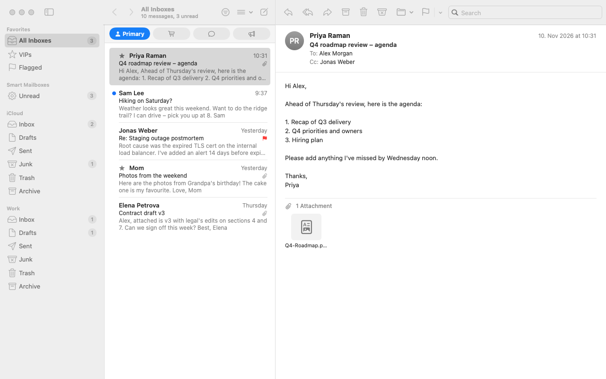

# MacExchangeClient

A native macOS mail client in SwiftUI. It starts as a faithful replica of the Apple Mail main window, and the goal is to connect it to real mail servers.

<picture>
  <source media="(prefers-color-scheme: dark)" srcset="docs/screenshots/dark.png">
  
</picture>

> **Status:** the UI and behaviour run on built-in sample messages kept in memory. There is no IMAP, SMTP or Exchange connection yet. See [Roadmap](#roadmap).

## Features

- **Three-column window** with a mailboxes sidebar, a message list and a message view, using Mail's toolbar layout and SF Symbols
- **Favorites and smart mailboxes:** All Inboxes, VIPs, Flagged, Unread, then each account's Inbox, Drafts, Sent, Junk, Trash and Archive, with unread badges
- **Categories:** Primary, Transactions, Updates and Promotions in the Inbox (⌥⌘1–4)
- **Message actions:** reply, reply all, forward, archive, delete, junk, flag in seven colours, mark read or unread. After an action the next message is selected, as in Mail
- **Drag & drop:** drag messages onto a mailbox to move them, also to another account. Drop them on Flagged to flag them, or on All Inboxes to put each back in its own Inbox
- **Search** across the whole account (not Trash or Junk), plus an unread filter
- **Compose window** with reply quoting, Send and Save Draft
- **Swipe actions:** swipe right for Unread, left for Trash or Flag
- **Menu bar and shortcuts** taken from Mail's own `MainMenu.nib`
- **Light and dark mode**

## Getting started

You need macOS 14 or later and Swift 6. Command Line Tools are enough; Xcode is not needed.

```sh
git clone https://github.com/tillg/MacExchangeClient.git
cd MacExchangeClient
./run.sh          # build and launch
./run.sh build    # build only
./run.sh test     # run the model tests
```

<details>
<summary>Why <code>run.sh</code> and not <code>swift run</code>?</summary>

In the macOS 27 SDK, `@State` is a macro whose plugin (`SwiftUIMacros`) ships only with Xcode. So `run.sh` builds the app against the macOS 26.5 SDK. The tests use the default SDK, because the Swift Testing macros live there, and get their own build folder (`.build/tests`) so the two setups don't spoil each other's cache. With Xcode installed, `swift run` works as is.
</details>

### Keyboard shortcuts

| Action | Keys | | Action | Keys |
|---|---|---|---|---|
| New message | ⌘N | | Archive | ⌃⌘A |
| Get Mail | ⇧⌘N | | Delete | ⌘⌫ |
| Reply | ⌘R | | Junk | ⇧⌘J |
| Reply All | ⇧⌘R | | Read / Unread | ⇧⌘U |
| Forward | ⇧⌘F | | Toggle flag | ⇧⌘L |
| Send | ⇧⌘D | | Unread filter | ⌘L |
| Go to mailbox | ⌘1–9 | | Category | ⌥⌘1–4 |

## Project layout

```
Sources/
  MailModel/        MailStore (@MainActor @Observable), the models and the drag payload; all behaviour lives here
  MailReplica/      SwiftUI views, MailCommands (menu bar), DebugSnapshot
Tests/
  MailModelTests/   Swift Testing suites for MailStore and the drag payload (23 tests)
docs/screenshots/   README images
run.sh              build / launch / test
```

Views stay thin. Every action is a method on `MailStore`, and each one has a test.

### Screenshots without screen recording

The app can save a PNG of its window and quit. This checks the UI without screen-recording permission:

```sh
MAIL_SNAPSHOT=$PWD/tmp/snap.png .build/debug/MailReplica
MAIL_SNAPSHOT=$PWD/tmp/snap-dark.png MAIL_SNAPSHOT_DARK=1 .build/debug/MailReplica
```

## How faithful is it?

The details come from Mail.app's own resources in `/System/Applications/Mail.app/Contents/Resources`: nibs, `MainWindow.toolbar` and `*.loctable`.

✅ read from the bundle · ⚠️ estimated

| Area | What the replica does | Source |
|---|---|---|
| Window | Sidebar, message list, message view | ✅ nibs `MailboxesViewController`, `MessageListListLayoutViewController`, `MessageViewController` |
| Toolbar | toggle sidebar · back/forward · filter · view options · compose ‖ reply/reply all/forward · archive/delete/junk · move · flag ‖ search | ✅ `MainWindow.toolbar` default set and SF Symbol names |
| Sidebar | Favorites, Smart Mailboxes, per-account mailboxes, badges | ✅ `Sidebar*.icns` names · ⚠️ badge rules |
| Categories | Primary, Transactions, Updates, Promotions | ✅ `MainMenu.nib` · ⚠️ colours |
| Flags | Red, Orange, Yellow, Green, Blue, Purple, Gray | ✅ `MainMenu.nib` |
| Shortcuts | See table above | ✅ `MainMenu.nib` key equivalents |
| List row | Unread dot, bold sender, relative date, subject, 2-line preview, flag, paperclip, optional contact photo | ⚠️ drawn in code · ✅ fonts 13pt / 11pt |
| Behaviour | Marked read when shown; Delete goes to the account's Trash and deleting from Trash erases; Junk toggles; next message selected after an action; drag & drop as described above | ⚠️ tested in `MailStoreTests` |

## Roadmap

- [x] Main window, actions, compose, shortcuts
- [x] Drag & drop between mailboxes and accounts
- [ ] Backend protocol under `MailStore`, with the sample data as one implementation
- [ ] Reading mail over IMAP (first against a local Dovecot container)
- [ ] Sending over SMTP; flags, moves and deletes synced to the server
- [ ] MIME parsing, HTML message view, real attachments
- [ ] OAuth2 sign-in for Microsoft 365 / Exchange (Microsoft Graph) and Gmail
- [ ] Local cache and offline changes

**Not planned for now:** rules, conversation threading, rich-text compose, Remind Me, Follow Up, Mute, and the separate message window on double-click.
