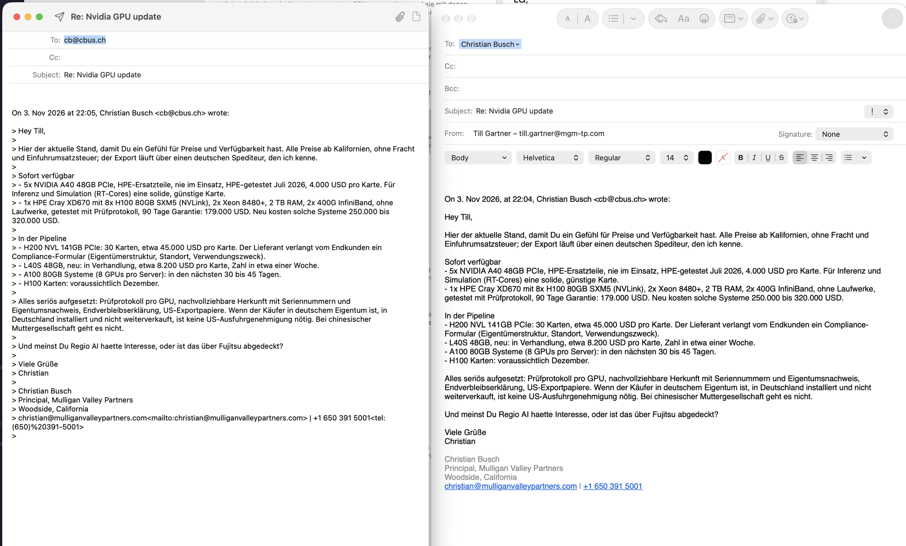

# Change spec: a compose window like Apple Mail's (compose-like-mail)

Status: ready to plan in steps · Written 2026-11-13 · Scope: the compose window's header fields and a formatting
bar. Four parts, each one shippable on its own; build them in the order below.

## Goal

Side by side, the same reply: **left our app, right Apple Mail.**

The user likes four things from Apple Mail's window (their words, 2026-11-13):

1. **Left-aligned labels.** "To:", "Cc:", "Bcc:", "Subject:", "From:" start at the window's left margin. Ours are
   right-aligned in a 92 pt column, so the labels jump and the fields start far in.
2. **A Bcc field.**
3. **Recipients shown by name**, e.g. "Christian Busch ▾" instead of "cb@cbus.ch". Mail takes the name from the Mac's
   Contacts.
4. **The formatting tools above the text:** paragraph style (Body), font (Helvetica), weight (Regular), size (14),
   text colour, B / I / U / S, alignment left / centre / right, lists.

What the screenshot shows in Mail (✅ seen in it):

- Label column: labels left-aligned at about 30 pt from the window edge, in secondary colour; the field starts right
  after the label, not in a common column ("To:" field starts earlier than "Subject:" field).
- Every field on its own row with a hairline below, full width.
- Order: To, Cc, Bcc, Subject (with a priority "!" popup on its right), From ("Till Gartner – till.gartner@mgm-tp.com")
  with Signature ("None") on the right, then the format bar, then the text.
- The recipient is a blue rounded token with the person's name and a small chevron (a menu).
- The format bar is a row of controls under the header, above the text, not in the toolbar.

## Non-goals (seen in the screenshot, not asked for now)

- Priority popup ("!") → feature map chapter 47.
- Signature picker → feature map chapter 1.
- Quoting the original as formatted text instead of "> " lines → feature map chapter 6 (it depends on part 4, see
  there).
- The window toolbar's other buttons (text size A/A, lists, emoji, photo browser, Hide My Email).

## Current state (read these first)

- `Sources/MailReplica/ComposeView.swift`
  - `field(_:_:)` (bottom of the file): `Text(label)…frame(width: 92, alignment: .trailing)` — the right-aligned
    column. Used for To, Cc, Subject, From and the invite-answer fields.
  - To and Cc are plain `TextField`s bound to `draft.to` / `draft.cc` (strings, comma/semicolon separated,
    `Contact.parseList`).
- `Sources/MailReplica/ComposeTextView.swift`: an `NSTextView`, `isRichText = true` only for attachments; typing
  attributes are reset to `DropTextView.plain`. The text is sent as plain text unless pictures are placed (then HTML
  with `
` per line, `Draft.html`).
- `Sources/MailModel/Models.swift` `Draft`: `to`, `cc`, `subject`, `body`, `attachments`; no `bcc`.
- `Sources/EWS/EWSBackend.swift` `createRequest`: `ToRecipients`, `CcRecipients`; Body as Text, or HTML when pictures
  are placed.
- `docs/feature-map.md` chapters 2 (autocomplete), 4 (Bcc), 5 (rich text), 49 (contact card). README "Not planned":
  rich-text compose — **this spec reverses that for part 4, at the user's request** (2026-11-13).

## Design

### Part 1 — left-aligned labels (small)

- `field(_:_:)`: label `.frame(alignment: .leading)` with no fixed width, `.fixedSize()`, 6 pt to the field;
  leading padding 20 pt. Same for all rows, the invite-answer rows included.
- Test: snapshot only (`MAIL_SNAPSHOT_ANSWER=reply`, light and dark, 1280×800): labels flush left, fields start right
  after each label, hairlines full width.

### Part 2 — Bcc

- Model: `Draft.bcc: String` (Codable with a default, so stored drafts without it still decode).
- EWS: `createRequest` writes `<t:BccRecipients>` after `CcRecipients` (schema order in `t:MessageType`:
  ToRecipients, CcRecipients, BccRecipients); leave out recipients without an address (BUG-215 rule).
- View: a Bcc row under Cc, always shown (as in the screenshot).
- Drafts saved to Exchange keep Bcc; a draft opened from Drafts fills it (`message:BccRecipients` in the body request
  for messages in Drafts).
- MailTips/size and "When Adding Recipients" treat Bcc like Cc.
- Tests (MailModel, write first): `draftBccSurvivesEncoding`, `createRequestWritesBccInSchemaOrder`,
  `bccWithoutAddressIsLeftOut`, `addingABccRecipientCountsAsNew` (When Adding Recipients).

### Part 3 — recipients shown by name

- Tokens: To/Cc/Bcc show one token per recipient: the name if known, else the address; the token's menu shows the
  address and offers Copy Address, Remove. Typing still works as text; a comma, semicolon or Return turns the typed
  text into a token. Simplest robust build: an `NSTokenField` wrapped in `NSViewRepresentable`, whose represented
  objects are `Contact`s.
- Where the name comes from, in this order:
  1. the name already in the draft ("Christian Busch <cb@cbus.ch>", as replies write it today);
  2. the original message's From/To/Cc (a reply's recipients are known there);
  3. the Mac's Contacts (`CNContactStore`, read only, matching on email). Needs the Contacts permission
     (`NSContactsUsageDescription` in the app's Info.plist, which `run.sh`'s `bundle` writes). If the user declines,
     steps 1–2 still give names.
- What is sent doesn't change: `Contact.formatted` ("Name <address>"), so Exchange gets the same addresses.
- Tests (MailModel): `recipientNameComesFromTheDraftThenTheOriginal` (a resolver `MailStore.displayName(for:email:)`
  that takes a lookup closure for Contacts, so no real Contacts in tests); `sentRecipientsAreUnchanged`.
- Risk: the Contacts prompt appears on first use; ask only when a compose window opens, not at launch.

### Part 4 — formatting bar and rich text (large)

- Bar under the header, above the text, as in Mail: paragraph style menu (Body, Title, Heading, Subheading),
  font family, weight, size, colour well, B / I / U / S toggles, alignment (left/centre/right), list menu (bulleted,
  numbered). Built on the `NSTextView` (`ComposeTextView`): these are standard `NSFontManager` / text-view actions;
  stop resetting typing attributes to plain once the message is rich.
- Format menu in the menu bar with Mail's titles and shortcuts from `MainMenu.nib` (Bold ⌘B, Italic ⌘I, Underline
  ⌘U, Bigger ⌘+, Smaller ⌘−, Align Left ⌘{, Center ⌘|, Right ⌘}, Increase/Decrease Indentation ⌘] / ⌘[, Lists),
  and Format ▸ Make Plain Text / Make Rich Text ⇧⌘T.
- Sending: a rich message goes as HTML, generated from the attributed string (bold → `<b>`, italic → `<i>`,
  underline → `<u>`, strike → `<s>`, font/size/colour → inline `style`, alignment → `
`,
  lists → `<ul>/<ol><li>`), extending today's `Draft.html` (which already writes `
` per line and `cid:`
  pictures). A plain message stays plain text, as today.
- Tests (MailModel, write first): `boldItalicUnderlineBecomeTags`, `fontSizeColourBecomeInlineStyle`,
  `alignmentAndListsBecomeBlocks`, `plainTextStaysPlain`, `htmlIsEscaped` (text with `<` and `&`), on a pure
  `RichText.html(from:)` function in MailModel taking a list of runs (so no AppKit in tests); the view converts its
  `NSAttributedString` into those runs.
- Update README: remove "rich-text compose" from "Not planned"; Features ▸ Compose window.

## Acceptance

- Part 1: labels left-aligned in compose and in invite answers, light and dark (snapshot read and checked at 1×).
- Part 2: Bcc can be typed, is saved with a draft, reopens with it, and is sent; recipients don't see Bcc addresses.
- Part 3: a reply to Christian shows "Christian Busch"; a new address of someone in Contacts shows their name after
  Contacts access is allowed; declining access keeps addresses working.
- Part 4: bold/italic/underline/strike, font, size, colour, alignment and lists show in the sent mail in Apple Mail
  and Outlook; a message without formatting is still sent as plain text.
- Each part: README Features, `specs/system/functional.md` ("Compose") and a What's New line.

## Open decisions (defaults chosen; flag if wrong)

- **Bcc row always visible** (as in the screenshot) rather than behind View ▸ Bcc Address Field (⌥⌘B). Default:
  always visible.
- **Token field vs. names in a plain text field:** tokens (as in Mail). Cheaper alternative: keep the text field and
  show "Name <address>" — but that is what the screenshot's left side already does badly.
- **Contacts access:** asked on the first compose window. Alternative: only after a Settings switch.
- **Rich by default?** Mail's default is Rich Text (Settings ▸ Composing ▸ Message format). Default here: rich, but
  sent as plain text when nothing is formatted.

## Risks and notes

- Part 4 is the biggest piece of compose work so far; HTML output must survive Outlook and Exchange. Test against the
  live server with `EWS_WRITE_TEST=1` (sends nothing; saves a draft in `MailReplica-Test`) and read it back.
- `NSTokenField` and SwiftUI focus (`@FocusState inRecipients`, used for When Adding Recipients) need care: the
  "leaving To/Cc" check must still fire.
