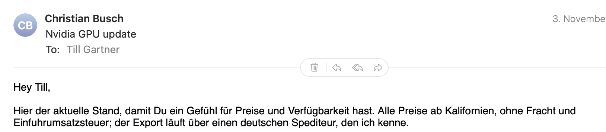

# Change spec: action buttons over the message (message-hover-actions)

Status: ready to implement · Written 2026-11-13 · Scope: a small row of buttons (Delete, Reply, Reply All, Forward)
on the line between a message's header and its text, in the message pane, for each message card.

## Goal

Apple Mail puts four small buttons on the separator line between a message's header and its text: Delete, then
Reply, Reply All and Forward, in a rounded capsule. They act on **that** message. With a conversation open, every
message card has its own, so you can answer or delete one message of the conversation without selecting it in the
list first. We want the same.

What the screenshot shows (✅ seen in it):

- A capsule with a thin grey border and a white fill, centred horizontally on the separator line between the header
  (sender, subject, To) and the text. The line runs from the left text margin to the right edge, behind the capsule.
- Four icons, grey, no labels: Delete (trash), a thin vertical divider, Reply, Reply All, Forward. The divider
  separates Delete from the three answer buttons.
- The capsule is small: about the height of one line of the header's To row.

Recalled from Mail, not seen in the screenshot (⚠️, check against Mail when building):

- ⚠️ The capsule shows only while the pointer is over the message card, and fades in and out.
- ⚠️ Each button has a tooltip: "Delete", "Reply", "Reply All", "Forward".
- ⚠️ A message in Trash: Delete erases it (as the toolbar's Delete does there).

## Non-goals

- No new actions: only these four. Archive, Junk, Flag and Move stay in the toolbar and menus.
- No change to the toolbar, the menu bar or the list's context menu and swipes.
- No separate message window (still not planned, README).

## Current state (read these first)

- `Sources/MailReplica/MessageDetailView.swift`
  - `ConversationView` shows the selected message and the rest of its conversation, one card per message
    (`MessageContent`).
  - `MessageContent.body`: `MessageHeader`, then either the invite card or a `Divider()` followed by the text. That
    `Divider()` is the line the capsule sits on. An invite has no divider there today (`InviteCard` +
    text with `DayColumn`).
- `Sources/MailReplica/MailCommands.swift` `reply(_:)`: Reply / Reply All / Forward open the compose window with
  `store.loadedDraft(kind, to: id, includeAttachments: includeMode)`; it loads a body not opened yet first.
- `Sources/MailModel/MailStore.swift`
  - `delete(_ ids:)`: to the account's Trash, erased in Trash; selection rules ("No hidden selection",
    functional.md).
  - `withConversations(_:)`: what list actions use. The capsule must **not** use it: it acts on one message.
  - `loadedDraft(_:to:includeAttachments:)`.
- `specs/system/functional.md` "Message view and conversations", "Actions and selection".

## Design

### View: `MessageActionBar` (new, in `MessageDetailView.swift`)

- Four borderless icon buttons in an `HStack`, inside a `Capsule` with `.background` (window background colour) and a
  1 px `separatorColor` stroke; a 1 px-wide, 14 pt-high divider between Delete and Reply.
- SF Symbols, the same the toolbar uses: `trash`, `arrowshape.turn.up.left`, `arrowshape.turn.up.left.2`,
  `arrowshape.turn.up.right`. Secondary colour; the button under the pointer in primary.
- `.help("Delete")`, `.help("Reply")`, `.help("Reply All")`, `.help("Forward")`.
- Placement: in `MessageContent`, replace the plain `Divider()` above the text by a `ZStack` of the divider and the
  capsule, centred. For an invite, put the same line + capsule between the header and the invite card.
- Shown while the pointer is over the card (`onHover` on `MessageContent`), with a short fade
  (`.opacity`, `.animation(.easeInOut(duration: 0.15))`). Hidden while taking a snapshot unless
  `MAIL_SNAPSHOT_ACTIONS=1` (so the snapshot hook can show it, see Tests).
- Light and dark mode: colours from the system (`windowBackgroundColor`, `separatorColor`, `.secondary`), so the
  capsule matches the header area. On an HTML mail's white page the capsule stays above the page, on the line.

### Actions (all on the card's message id `m.id`, never on the list selection)

| Button | Does |
|---|---|
| Delete | `store.deleteMessage(m.id)` (new, see below) |
| Reply / Reply All / Forward | open the compose window with `await store.loadedDraft(kind, to: m.id, includeAttachments: includeMode)`, the same as `MailCommands.reply`, but for `m.id`. Move that helper so both use it (e.g. a `ReplyOpener` view modifier or an `@Environment(\.openWindow)` closure in `MessageContent`) |

### Model: `MailStore.deleteMessage(_ id:)`

`delete(_:)` already handles Trash (erase) vs. other mailboxes (move to Trash). The capsule needs one message, and
the selection must follow the existing rules:

- The card's message is the selected one (or the row standing for it): same as Delete in the toolbar —
  the next message is selected.
- Another card of the open conversation: that message goes; the selection stays on the conversation row, which
  still stands for the conversation (BUG-155 rules in `keepingSelectionVisible`).
- No `withConversations`: only that message.

If `delete([id])` already does exactly this, `deleteMessage` is not needed: write the tests first and add it only
if they fail.

## Tests (write first, see that each fails, then implement)

Store (`Tests/MailModelTests/MailStoreConversationTests.swift`):

1. `deletingOneCardOfAConversationDeletesOnlyThatMessage`: a conversation of three, open; delete the middle card's
   message by id → it is in Trash, the other two stay where they were, the row stays selected.
2. `deletingTheOpenMessagesCardSelectsTheNextRow`: a single message selected; delete it by id → as toolbar Delete
   (next message selected).
3. `deletingACardInTrashErasesIt`: in Trash, delete by id → erased (gone, `DeleteItem` queued for Exchange mail).
4. `replyFromACardAnswersThatMessage`: `loadedDraft(.reply, to: olderCard)` → To/Subject from the older message,
   not the newest of the conversation.

UI (snapshot, `tools/snapshot.sh`):

5. `MAIL_SNAPSHOT_ACTIONS=1` shows the capsule on every card. Snapshot light and dark at 1280×800 with the sample
   conversation selected; read the PNGs: capsule centred on the line, four icons, divider after the trash, nothing
   overlapping the header or the first text line; also on the sample invite and the HTML newsletter.

## Acceptance

- Hovering a message card shows the capsule on the line under its header; leaving hides it (⚠️ behaviour as in Mail).
- Each button acts on its own card's message, also inside a conversation; the list selection follows the existing
  rules.
- Light and dark mode look as in the screenshot (sizes may differ by a point).
- `README.md` Features ("Message actions") mentions the buttons over the message; `specs/system/functional.md`
  "Message view and conversations" describes them; a What's New line for today.

## Open decisions (defaults chosen; flag if wrong)

- **Always visible vs. on hover:** on hover (⚠️ as recalled from Mail). Alternative: always visible, simpler and
  findable, but busier with long conversations.
- **Invite cards:** get the capsule too (Delete and answers work on invites; the invite's own Accept/Decline stay
  in the invite card).
- **Messages from another mailbox in the conversation ("Found in Sent")**: get the capsule too; Reply on your own
  sent message goes to its recipients (existing reply rule).

## Risks and notes

- `onHover` on a card that contains a `WKWebView` (`HTMLBodyView`): the web view may swallow hover events. Put the
  hover tracking on the whole card (header included) and test that moving into the HTML keeps the capsule visible.
- Keyboard users: the buttons are reachable with Tab only when visible; the toolbar and shortcuts remain the
  keyboard path.
