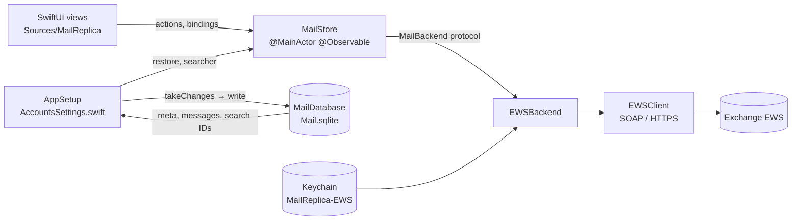
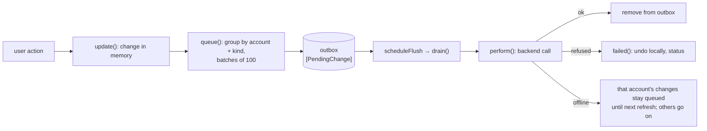

# Architecture

How the parts of Mail Replica fit together and how data moves between memory, the server and disk. What a user
sees: [functional.md](functional.md). Types: [domain-model.md](domain-model.md). Disk: [storage.md](storage.md).
Server protocol: [ews.md](ews.md).

## Targets

`Package.swift` (Swift tools 6.0, macOS 14) has four targets:

| Target | Kind | Depends on | Holds |
|---|---|---|---|
| `MailModel` | library | — (system: WebKit, for `HTMLPage`'s body-view helpers) | `MailStore`, the models, `MailBackend` protocol, `MailDatabase` (SQLite), `MailCache` (old JSON), `HTMLPage`, `Invite`, `MessageDrag`, `WhatsNew` |
| `EWS` | library | `MailModel` | `EWSBackend` (the `MailBackend` over EWS), `EWSClient` (SOAP over HTTPS), `ExchangeAccount`, `Keychain` |
| `MailReplica` | executable | `MailModel`, `EWS` | SwiftUI views, `AppSetup`, `MailCommands`, `SampleData`, `DebugSnapshot`, `AppIcon` |
| `MailModelTests` | tests | `MailModel`, `EWS` | Swift Testing suites; live EWS tests run only with `EWS_USER`/`EWS_SERVER` set |

All behaviour lives in `MailStore`; views call its methods and read its state. Views hold only view state
(expanded folders, back/forward history, remote content allowed for a message).

## Components

- `MailStore` (`Sources/MailModel/MailStore.swift`) holds every message in one array, `messages`, plus accounts,
  folder trees, sync tokens, the outbox, selection, search state and status text. Each change bumps a `revision`;
  sidebar counts, the visible list, the position of the selected message (`selectedMessage`) and its conversation are
  cached per revision.
- `MailStore` talks to servers only through `MailBackend` (`Sources/MailModel/MailBackend.swift`): folders,
  newest N, `sync(folder, token)`, body, inline images, attachment content, MailTips size, calendar events, and the
  write operations. `EWSBackend` is the only implementation.
- `MailStore` holds no database handle (it uses only the types and `searchLimit` from `MailDatabase.swift`). `AppSetup` (`Sources/MailReplica/AccountsSettings.swift`) moves changes
  between the two and gives the store a `searcher` closure over `MailDatabase.search`.

## Start-up

1. `AppSetup.makeStore()`: if Exchange accounts are saved (UserDefaults `exchangeAccounts`) and `MAIL_SAMPLE_DATA`
   is not set, an empty store gets one `EWSBackend` per account (password from the Keychain; without one the
   account is added without a backend, still as a server account whose changes wait, and the status says
   "Password needed for …"). Otherwise the store gets `SampleData.store()`, and
   nothing is read from or written to disk.
2. `pollForMail()` (`MailReplicaApp.swift`) runs `AppSetup.loadMail`, then loops: `store.refresh()`,
   `AppSetup.saveChanges(store)`, sleep 15 s. It is off while `MAIL_SNAPSHOT` is set.
3. `loadMail`: without `Mail.sqlite`, `MailDatabase.importCache` moves `Cache.json` in (see [storage.md](storage.md)).
   Otherwise, on a detached task: open the database, read `meta()` and the Inbox of every account. The store
   `restore`s meta (sync tokens, folders, outbox; `loadedBoxes = []`), then the Inboxes. A second task reads the rest
   (`messages(notIn:)`) and calls `finishLoading`, which allows flushing and starts the history sync. Both add only
   mail of the accounts set up: the stored mail of an account no longer in the list stays on disk, unloaded. Then
   `prepareSearch()` builds the search index if the database is older, and `enableSearch` sets the store's `searcher`.
4. While loading (`isLoading`), the quick check covers only mailboxes already in memory, and the outbox is not
   flushed: the server renames moved messages, and messages not yet in memory would keep old IDs.
5. If loading fails, the database is dropped for the session (nothing is saved until relaunch) and search falls
   back to memory.

## Reading from the server

- **Quick check** (`refresh`): every 15 s, on Get New Mail, on pull to refresh and when the selected mailbox changes.
  It first flushes the outbox and waits for it. Then, per account not paused: read the folder list once per session
  (`setRemoteFolders`; a folder of the stored tree the list no longer has was removed on the server: its mail leaves
  memory and disk, also mail loaded later during launch, its sync position goes, and if it was selected, the
  account's Inbox is selected), and for the Inbox plus the selected mailbox of that account either sync changes (folder complete) or merge the
  newest 50 (`firstScreen`). Then it starts the history sync. A second `refresh` while one runs returns at once.
- **Status line:** notices about an account's connection — its failed check ("Name: error"), and "Offline – …" /
  "Exchange is busy – …" from the outbox — are noted per account (`connectionNotices`). That account's next
  successful check clears its own notice (to `historyError`), only while it is still the one shown. Other notices
  ("Couldn't send …", "Exchange refused a change", sign-in, files) are not cleared by checks; the next notice replaces them.
  A load cancelled because the view that asked moved on (another message selected, a compose window closed:
  `CancellationError` or `URLError.cancelled` while the task is cancelled, `MailStore.wasCancelled`) reports nothing:
  body, `cid:` pictures, the calendar day, attachment files and a forward's original files.
- **History** (`syncHistory`): phase 1 fetches the newest 200 of every incomplete folder, merged in batches of
  1.5 s. Phase 2 syncs one folder at a time in pages of 512 (`MaxChangesReturned`), collecting pages for up to 1.5 s
  (`historyBatch`) and applying them in one merge; after each batch the next folder is chosen again. Order:
  the selected mailbox, then Inbox, Drafts, Archive, Junk, Trash, the user's folders, Sent last. A folder that fails
  is skipped for the session; a `URLError` or a `ServerBusy` with a back-off (throttling) sets that account aside until the next check, while the
  other accounts go on (`nextHistoryFolder(skipping:)`); a `ServerBusy` without one (a page that isn't an Exchange
  answer) fails only that folder. Phase 3 syncs changes of every complete folder that the
  quick check doesn't cover, for the accounts not set aside.
- **Progress:** `progress` shows "Synchronizing “name”" with the share of the server's `TotalCount` already here.
- **Merge rules** (`merge`): a known `remoteID` keeps its local ID; a server flag keeps the local colour; a summary
  doesn't drop a loaded body, attachments, invite or HTML, nor the body's addresses (`keeping`: a names-only contact
  naming the same person keeps the loaded one) or its paperclip state. A summary that names other people or has another
  preview (a draft edited elsewhere; a nil stored preview counts as unchanged, a new subject alone doesn't) replaces
  the contacts and drops the loaded body, which is fetched again when shown; a message with a pending outbox change keeps the property
  that change sets (read state for `setRead`, flag for `setFlagged`, mailbox for a move or an invite answer, all of
  them for an erase) and takes the server's read state, flag and mailbox for the others (`Guarded`). The same
  holds for a change already written after the answer was requested: every server read notes `requestStamp` before
  its request and passes it as `asked`; each written change notes per server ID and property the stamp after its
  write (`written`, in memory), so an older answer keeps that property and doesn't bring back an ID erased or moved
  away since; an upsert for a message gone here (erased) while a change for it is queued is
  skipped, so a page fetched before the erase reached the server doesn't bring it back (likewise at launch, for a
  message moved offline whose stored copy isn't in memory yet: `finishLoading` then adds that copy, once). A deletion reported for a message with a pending move is held, not applied
  (`deletedWhileMoving`, in memory): the move makes its source report it. A move that goes through drops it; a
  refused move removes the message instead of moving it back. Other deletions win. If nothing changed, `messages` is not reassigned.
- **Sync from the start** (no token: a new folder, after the conversation upgrade): when it begins, the store notes
  the server IDs the folder holds (`unlisted`); each page ticks off what it lists. When the pass completes, the
  folder's server messages it didn't list are removed (deleted or moved elsewhere meanwhile). One with a queued
  change stays until that change is done (`drain` checks again). In memory only: a pass interrupted by quitting
  resumes from its token and removes nothing.
- **Rejected token** (`SyncTokenRejected`, Exchange's `ErrorInvalidSyncStateData`): the quick check, the history and
  the background checks forget that folder's token and `complete` mark (`resetSync`); it syncs again from the start
  and the rule above removes what is gone. Once per folder and session: a second rejection puts the folder on the
  history's failed list with a status instead.
- Bodies, inline images, calendar days, attachment content and MailTips are fetched on demand by the views. A body
  whose message got another preview from the server while it was on its way (`loadBody`) is the old
  version's: it is dropped and asked for again, up to three requests in all.

## Writing to the server: the outbox

- Every action on server mail changes memory at once (`update`). Read, flag (flagged or not; colours stay local) and
  mailbox changes are grouped per account and kind, in a stable order, as `ServerChange`s of at most 100 IDs. Each
  `PendingChange` keeps the messages as they were, to undo.
- Erasing from Trash, Send, Save Draft and invite answers append their own changes.
- `drain` sends changes one at a time, oldest first, for accounts with a backend that are not paused. Before a
  `send` goes out it is marked `inFlight` and `saveBeforeSending` writes the changes to disk and is awaited
  (`AppSetup.saveAndWait`). At launch `restore(meta)` keeps a send still marked in flight in Drafts on this Mac
  instead of queueing it, with a status to check Sent.
  - `AuthenticationError`: the account is paused until relaunch; nothing more is sent or fetched for it.
  - `URLError` on `send`, `respond` or `reply`: treated as refused (`failed`), never retried, since it may have gone out.
  - Any other `URLError`: status "Offline – changes will be sent to Exchange later"; the change and every later one
    of that account stay queued, in order, for the next refresh, while other accounts' changes go on.
  - `ServerBusy` (throttling, a gateway's error page, a non-answer): like a `URLError`. A send or answer goes to
    `failed`; other changes of that account stay queued in order (status "Exchange is busy – changes will be sent
    later"), and with a back-off none of them is sent before it has passed (`busyUntil`, in memory, in `canSend`).
  - `PartlyRefused` (some items of a batch refused): the new IDs of the moved items are applied (`renameRemote`) and
    only the refused items go to `failed`; their `previous` messages are matched to the change's IDs by position.
  - Any other error: `failed` — a send or draft is kept as a local message in Drafts, its files stored with it (pictures
    placed in the text stay in place through an HTML body, see rendering.md); the status
    says "Couldn't send “…”" or "Couldn't save the draft “…”" ("(No Subject)" without one). Other changes restore only
    the property they set, and only while it still holds the value they set: read state (`setRead`), flag
    (`setFlagged`), mailbox (`move`), the invite (and the mailbox, if still in Trash) for invite answers. A later
    change to the same message stays. Only a refused erase (`delete`) re-adds a message that is gone; a message
    erased after the refused change stays gone. Status shows the reason. The batch's messages are found in one pass
    over all messages (an index by local ID), not one search each.
- A move needs the folder list (read on demand) and renames the moved messages to the new IDs Exchange returns,
  in memory and in the queued changes, including the copies they keep for undoing (`renameRemote`). If the destination's sync already brought a moved item under
  its new ID, that copy is dropped first; the moved message keeps its local ID, body and selection. An answer sent with "Do Not Send a Response" and Remove from
  Calendar also move the item to Trash on the server (`moveToTrash`, after the answer went out), reading the folder
  list first if it isn't known yet. If the server can't be reached, is busy or sign-in fails, that move is queued as
  an ordinary `.move(…, to: .trash)` with nothing to undo; any other failure means the server moved it already.
- Exchange messages can't move to another account: `update` reverts such a change and sets a status.

## Saving to disk

`AppSetup.saveChanges` calls `store.takeChanges()` (changed and removed IDs, and sync, folders and outbox when
they changed) and writes them with `writeInBackground`. Changed messages are picked from a shared snapshot of the
array off the main thread (`StoreChanges.resolved`). On success the current search runs again; on failure the
changes are marked dirty again (`retry`) and the status shows the error. On quit, `write` runs synchronously.
Only server accounts are stored; sample data never is.

## Threading

- `MailStore` and all views run on the main actor. Network calls are `async` and suspend the main actor.
- `MailDatabase` runs every write and read on one serial `DispatchQueue` with one read-write connection; search runs
  on a second queue with its own read-only connection, opened lazily (WAL lets it read during writes).
- Loading, importing and search run in `Task.detached`. The search hit list is filtered in 8 chunks with
  `DispatchQueue.concurrentPerform` (`hitList`).
- Bodies and HTML are rendered in `WKWebView` with content JavaScript off ([rendering.md](rendering.md)).
