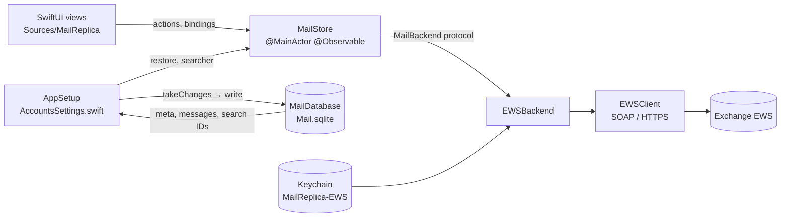
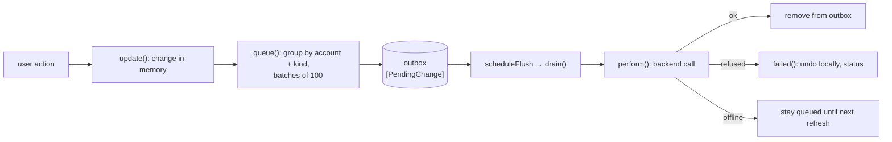

# Architecture

How the parts of Mail Replica fit together and how data moves between memory, the server and disk. What a user
sees: [functional.md](functional.md). Types: [domain-model.md](domain-model.md). Disk: [storage.md](storage.md).
Server protocol: [ews.md](ews.md).

## Targets

`Package.swift` (Swift tools 6.0, macOS 14) has four targets:

| Target | Kind | Depends on | Holds |
|---|---|---|---|
| `MailModel` | library | — | `MailStore`, the models, `MailBackend` protocol, `MailDatabase` (SQLite), `MailCache` (old JSON), `HTMLPage`, `Invite`, `MessageDrag`, `WhatsNew` |
| `EWS` | library | `MailModel` | `EWSBackend` (the `MailBackend` over EWS), `EWSClient` (SOAP over HTTPS), `ExchangeAccount`, `Keychain` |
| `MailReplica` | executable | `MailModel`, `EWS` | SwiftUI views, `AppSetup`, `MailCommands`, `SampleData`, `DebugSnapshot`, `AppIcon` |
| `MailModelTests` | tests | `MailModel`, `EWS` | Swift Testing suites; live EWS tests run only with `EWS_USER`/`EWS_SERVER` set |

All behaviour lives in `MailStore`; views call its methods and read its state. Views hold only view state
(expanded folders, back/forward history, remote content allowed for a message).

## Components

- `MailStore` (`Sources/MailModel/MailStore.swift`) holds every message in one array, `messages`, plus accounts,
  folder trees, sync tokens, the outbox, selection, search state and status text. Each change bumps a `revision`;
  sidebar counts, the visible list and the conversation of the selected message are cached per revision.
- `MailStore` talks to servers only through `MailBackend` (`Sources/MailModel/MailBackend.swift`): folders,
  newest N, `sync(folder, token)`, body, inline images, attachment content, MailTips size, calendar events, and the
  write operations. `EWSBackend` is the only implementation.
- `MailStore` holds no database handle (it uses only the types and `searchLimit` from `MailDatabase.swift`). `AppSetup` (`Sources/MailReplica/AccountsSettings.swift`) moves changes
  between the two and gives the store a `searcher` closure over `MailDatabase.search`.

## Start-up

1. `AppSetup.makeStore()`: if Exchange accounts are saved (UserDefaults `exchangeAccounts`) and `MAIL_SAMPLE_DATA`
   is not set, an empty store gets one `EWSBackend` per account (password from the Keychain; without one the
   account is added without a backend and the status says so). Otherwise the store gets `SampleData.store()`, and
   nothing is read from or written to disk.
2. `pollForMail()` (`MailReplicaApp.swift`) runs `AppSetup.loadMail`, then loops: `store.refresh()`,
   `AppSetup.saveChanges(store)`, sleep 15 s. It is off while `MAIL_SNAPSHOT` is set.
3. `loadMail`: without `Mail.sqlite`, `MailDatabase.importCache` moves `Cache.json` in (see [storage.md](storage.md)).
   Otherwise, on a detached task: open the database, read `meta()` and the Inbox of every account. The store
   `restore`s meta (sync tokens, folders, outbox; `loadedBoxes = []`), then the Inboxes. A second task reads the rest
   (`messages(notIn:)`) and calls `finishLoading`, which allows flushing and starts the history sync. Then
   `prepareSearch()` builds the search index if the database is older, and `enableSearch` sets the store's `searcher`.
4. While loading (`isLoading`), the quick check covers only mailboxes already in memory, and the outbox is not
   flushed: the server renames moved messages, and messages not yet in memory would keep old IDs.
5. If loading fails, the database is dropped for the session (nothing is saved until relaunch) and search falls
   back to memory.

## Reading from the server

- **Quick check** (`refresh`): every 15 s, on Get New Mail, on pull to refresh and when the selected mailbox changes.
  It first flushes the outbox and waits for it. Then, per account not paused: read the folder list once per session,
  and for the Inbox plus the selected mailbox of that account either sync changes (folder complete) or merge the
  newest 50 (`firstScreen`). Then it starts the history sync. A second `refresh` while one runs returns at once.
- **History** (`syncHistory`): phase 1 fetches the newest 200 of every incomplete folder, merged in batches of
  1.5 s. Phase 2 syncs one folder at a time in pages of 512 (`MaxChangesReturned`), collecting pages for up to 1.5 s
  (`historyBatch`) and applying them in one merge; after each batch the next folder is chosen again. Order:
  the selected mailbox, then Inbox, Drafts, Archive, Junk, Trash, the user's folders, Sent last. A folder that fails
  is skipped for the session; a `URLError` stops the history until the next check. Phase 3 syncs changes of every
  complete folder that the quick check doesn't cover.
- **Progress:** `progress` shows "Synchronizing “name”" with the share of the server's `TotalCount` already here.
- **Merge rules** (`merge`): a known `remoteID` keeps its local ID; a server flag keeps the local colour; a summary
  doesn't drop a loaded body, attachments, invite or HTML; a message with a pending outbox change keeps its local
  read state, flag and mailbox. A deletion reported for a message with a pending move is ignored; other deletions
  win. If nothing changed, `messages` is not reassigned.
- **Sync from the start** (no token: a new folder, after the conversation upgrade): when it begins, the store notes
  the server IDs the folder holds (`unlisted`); each page ticks off what it lists. When the pass completes, the
  folder's server messages it didn't list are removed (deleted or moved elsewhere meanwhile). One with a queued
  change stays until that change is done (`drain` checks again). In memory only: a pass interrupted by quitting
  resumes from its token and removes nothing.
- Bodies, inline images, calendar days, attachment content and MailTips are fetched on demand by the views.

## Writing to the server: the outbox

- Every action on server mail changes memory at once (`update`). Read, flag (flagged or not; colours stay local) and
  mailbox changes are grouped per account and kind, in a stable order, as `ServerChange`s of at most 100 IDs. Each
  `PendingChange` keeps the messages as they were, to undo.
- Erasing from Trash, Send, Save Draft and invite answers append their own changes.
- `drain` sends changes one at a time, oldest first, for accounts with a backend that are not paused:
  - `AuthenticationError`: the account is paused until relaunch; nothing more is sent or fetched for it.
  - `URLError` on `send`, `respond` or `reply`: treated as refused (`failed`), never retried, since it may have gone out.
  - Any other `URLError`: status "Offline – changes will be sent to Exchange later"; the change stays first in line.
  - Any other error: `failed` — a send or draft is kept as a local message in Drafts. Other changes restore only
    the property they set, and only while it still holds the value they set: read state (`setRead`), flag
    (`setFlagged`), mailbox (`move`), the invite (and the mailbox, if still in Trash) for invite answers. A later
    change to the same message stays. Only a refused erase (`delete`) re-adds a message that is gone; a message
    erased after the refused change stays gone. Status shows the reason.
- A move needs the folder list (read on demand) and renames the moved messages to the new IDs Exchange returns,
  in memory and in the queued changes (`renameRemote`). An answer sent with "Do Not Send a Response" and Remove from
  Calendar also move the item to Trash on the server, ignoring failure.
- Exchange messages can't move to another account: `update` reverts such a change and sets a status.

## Saving to disk

`AppSetup.saveChanges` calls `store.takeChanges()` (changed and removed IDs, and sync, folders and outbox when
they changed) and writes them with `writeInBackground`. Changed messages are picked from a shared snapshot of the
array off the main thread (`StoreChanges.resolved`). On success the current search runs again; on failure the
changes are marked dirty again (`retry`) and the status shows the error. On quit, `write` runs synchronously.
Only server accounts are stored; sample data never is.

## Threading

- `MailStore` and all views run on the main actor. Network calls are `async` and suspend the main actor.
- `MailDatabase` runs every write and read on one serial `DispatchQueue` with one read-write connection; search runs
  on a second queue with its own read-only connection, opened lazily (WAL lets it read during writes).
- Loading, importing and search run in `Task.detached`. The search hit list is filtered in 8 chunks with
  `DispatchQueue.concurrentPerform` (`hitList`).
- Bodies and HTML are rendered in `WKWebView` with content JavaScript off ([rendering.md](rendering.md)).
